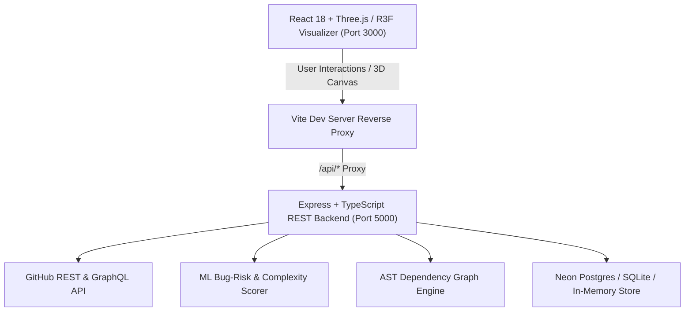

# 🪐 CodeGalaxy — 3D WebGL Code Architecture & Repository Visualizer

**CodeGalaxy** is a 3D repository visualization and software telemetry platform that transforms GitHub repositories into interactive solar systems and celestial galaxies. Folders orbit as planets, files orbit as moons sized by Lines of Code (LOC) and colored by ML bug-risk metrics, while unlinked assets drift as asteroid belts.

---

## 🌌 System Architecture



---

## ✨ Key Features

### 1. 🪐 3D WebGL Solar System Mode
- **Repository Sun**: Central glowing core with multi-layer corona shaders representing overall repository health and activity.
- **Folder Planets**: Top-level and second-level folders orbit with authentic 3D torus paths, sized by aggregate LOC and colored by aggregate risk.
- **File Moons**: Orbiting moons around their parent planet, featuring particle trails, risk heatmap colors, and interactive inspector popups.
- **Asteroid Belt**: Dynamic 3D dodecahedral asteroid field representing orphan files, dead code, and unreferenced asset debris.
- **3D Dependency Web**: Laser-blue connective lines tracing inter-file imports and circular dependency loops in real-time.
- **Time-Travel Commit Slider**: Scrub through repository commit history to observe file emergence and architectural evolution.

### 2. 🌌 Milky Way Galaxy Hub
- Macro view displaying featured repositories (React, Vue, Vite, Next.js, Jotai, Three.js) as swirling cosmic star systems.
- Clickable galaxy markers with telemetry cards, star count, fork metrics, and direct launch buttons.

### 3. 🤖 AI Chat Assistant & Code Inspector
- Built-in contextual AI copilot to analyze repository architecture, explain complex modules, and diagnose bug-risk hotspots.
- Side drawer inspecting file LOC, commit counts, top contributors, dependency lists, and recommended refactorings.

### 4. 🛡️ Dedicated Full-Stack Backend Service
- **Express + TypeScript**: High-performance REST API with CORS, input validation (Zod), and JWT authentication.
- **ML Bug-Risk Engine**: Heuristic algorithm evaluating LOC, commit churn, author diversity, recency, and bugfix ratios.
- **Fallback In-Memory Store**: Seamlessly functions without external database dependencies while supporting PostgreSQL/Neon via Drizzle ORM.

---

## 📁 Repository Structure

```
WAD_review-main/
├── backend/                  # Dedicated Express & TypeScript API server
│   ├── src/
│   │   ├── controllers/      # Auth & Repository analysis controllers
│   │   ├── db/               # Drizzle ORM schemas & database client
│   │   ├── middleware/       # JWT auth & rate limiting middleware
│   │   ├── routes/           # REST API endpoints (/api/auth, /api/repos)
│   │   ├── services/         # GitHub API, ML Scorer, AST Dependency Parser
│   │   └── server.ts         # Express entrypoint (Port 5000)
│   └── package.json
│
├── frontend/                 # React 18 + Three.js + Tailwind CSS Client
│   ├── src/
│   │   ├── components/
│   │   │   ├── canvas/       # Three.js / R3F Canvas components (SolarSystem, Galaxy)
│   │   │   └── ui/           # Navigation, Drawer, Chat, Sliders, Badges
│   │   ├── pages/            # Landing, Explore, Analyze, Dashboard, Login, Signup
│   │   ├── store/            # Zustand state stores (Auth, Repo, View, Galaxy)
│   │   └── main.tsx
│   ├── vite.config.ts        # Vite configuration with API reverse proxy
│   └── package.json
│
├── submissions/              # Standalone packages for Web Application Development course
│   ├── HTML_Submission/     # Pure semantic HTML5 + Accessible structure
│   ├── CSS_Submission/      # Deep cosmic CSS3 styling with glassmorphism & animations
│   └── Javascript_Submission/# Vanilla JS 2.5D interactive canvas visualizer & telemetry
│
├── submissions.zip           # Compressed submission bundle
└── package.json              # Monorepo root scripts
```

---

## 🚀 Quick Start Guide

### Prerequisites
- Node.js (v18 or higher)
- npm (v9 or higher)

### 1. Install Dependencies
```bash
# Install backend dependencies
cd backend && npm install

# Install frontend dependencies
cd ../frontend && npm install
```

### 2. Start the Backend API Server
```bash
cd backend
npm run dev
# Server running at http://localhost:5000
# Health check: http://localhost:5000/api/health
```

### 3. Start the Frontend Application
```bash
cd frontend
npm run dev
# Frontend running at http://localhost:3000
```

---

## 📡 REST API Reference

| Method | Endpoint | Description |
|---|---|---|
| `GET` | `/api/health` | Service health status & uptime |
| `POST` | `/api/auth/signup` | Register new user account |
| `POST` | `/api/auth/login` | Authenticate user & issue JWT |
| `GET` | `/api/auth/me` | Fetch active user profile |
| `POST` | `/api/auth/logout` | Invalidate active session |
| `POST` | `/api/repos/analyze` | Parse and analyze GitHub repository AST |
| `POST` | `/api/repos/process-job`| Dispatch background async analysis task |
| `GET` | `/api/repos/status` | Query status of background analysis job |

---

## 🧪 Submission Packages (WAD Review)

The `submissions/` directory contains distinct packages tailored for academic review:
- **HTML Submission**: Demonstrates semantic document layout, ARIA attributes, telemetry tables, and clean hierarchy.
- **CSS Submission**: Demonstrates dark cosmic theme, HSL palette, CSS Grid/Flexbox layouts, glassmorphism, responsive breakpoints, and keyframe animations.
- **JavaScript Submission**: Demonstrates vanilla DOM manipulation, HTML5 Canvas 2.5D rendering engine, state management, search/filter algorithms, and asynchronous repository telemetry calculation.

---

## 📜 License
MIT License &copy; 2026 CodeGalaxy Team
